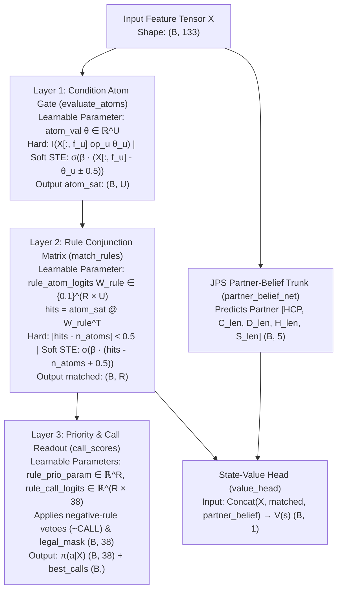
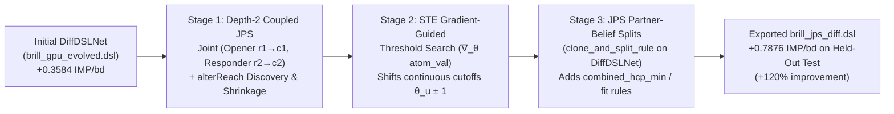
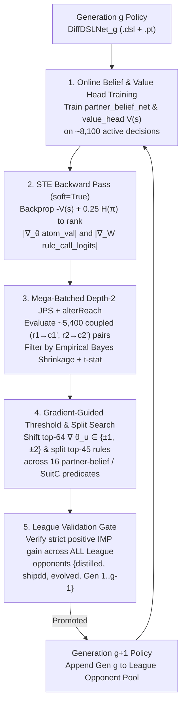

# `DiffDSLNet`: Neuro-Symbolic Differentiable DSL Network & Joint Policy Search

## 1. Motivation: Why Compile a `.dsl` Directly into Neural Network Weights?

Traditional approaches to Bridge bidding force an awkward trade-off between **symbolic rule systems** and **black-box neural networks**:

| Property | Pure Symbolic DSL ([`DecisionNet`](../src/bid/decision_net.py)) | Black-Box Neural Policy ([`BridgeA2CModel`](../../jps/python/a2c/model.py#L83-L190) / [`COTModel`](../src/bid/cot_model.py)) | **[`DiffDSLNet`](../src/bid/diff_dsl_net.py)** |
| :--- | :--- | :--- | :--- |
| **Step-0 Bidding Strength** | Strong ([`brill_gpu_evolved.dsl`](../system/brill_gpu_evolved.dsl)) | Random (`0%` accuracy) until millions of self-play games | **100% bit-identical to [`brill_gpu_evolved.dsl`](../system/brill_gpu_evolved.dsl) at step 0** |
| **Gradient Sensitivity ($\nabla_\theta$)** | None (hard boolean step functions) | Full backprop, but no domain structure | **Straight-Through Estimator (STE) gradients into exact rule thresholds & calls** |
| **Joint Policy Search (JPS)** | Local rule edits only; no gradient guidance | Needs replay buffer + SGD to generalize 1-deal search targets | **Global rule-level JPS + STE gradient-guided threshold/split search** |
| **Explainability** | 100% white-box | Black-box logits (or slow `25`-token autoregressive CoT) | **100% white-box ([`BidExplanation`](../src/bid/diff_dsl_net.py#L121-L145) + CoT string in 1 forward pass)** |
| **Round-Trip to `.dsl`** | Native | Impossible | **Lossless export via [`DiffDSLNet.export_dsl()`](../src/bid/diff_dsl_net.py#L755-L779)** |

[`DiffDSLNet`](../src/bid/diff_dsl_net.py#L148-L779) eliminates this trade-off by compiling any `.dsl` rule file directly into the parameters (`nn.Parameter`) of a 3-layer PyTorch `nn.Module`.

---

## 2. `DiffDSLNet` Architecture: How `.dsl` Logic Becomes Model Weights

Given a `.dsl` system with $F = 133$ features ([`src/bid/features.py`](../src/bid/features.py)), $U = 955$ unique condition atoms, $R = 1,840$ rules, and $A = 38$ bridge calls (`PASS, 1C..7NT, X, XX`), [`DiffDSLNet`](../src/bid/diff_dsl_net.py#L148-L779) maps the symbolic logic into three explicit neural layers plus a JPS partner-belief & value trunk:



### Layer 1: Condition Atom Gate ([`DiffDSLNet.evaluate_atoms`](../src/bid/diff_dsl_net.py#L314-L370))
- Every unique condition `(key, op, threshold)` across all rules in the `.dsl` is deduplicated into an atom index $u \in \{0, \dots, U-1\}$ with feature column `atom_feat[u]`, operator code `atom_op[u]`, and **learnable threshold parameter** `self.atom_val = nn.Parameter(tensor(U))` ($\theta_u$).
- **Hard Mode (`soft=False`)**: Evaluates exact comparisons (`==, !=, >=, <=, >, <, in, not_in`) against $\theta_u$, preserving half-integer distilled thresholds (`11.5`, `19.5`, `4.5`) bit-for-bit.
- **Differentiable STE Mode (`soft=True`)**: Computes smooth sigmoid gates with temperature $\beta = 10.0$:
  $$a_u^{\text{soft}}(X) = \begin{cases}
  \sigma\!\big(\beta (X_{f_u} - \theta_u + 0.5)\big) & \text{if } \text{op}_u \text{ is } \ge \\
  \sigma\!\big(\beta (\theta_u - X_{f_u} + 0.5)\big) & \text{if } \text{op}_u \text{ is } \le \\
  \sigma\!\big(\beta (X_{f_u} - \theta_u - 0.5)\big) & \text{if } \text{op}_u \text{ is } > \\
  \sigma\!\big(\beta (\theta_u - X_{f_u} - 0.5)\big) & \text{if } \text{op}_u \text{ is } <
  \end{cases}$$
  and returns the **Straight-Through Estimator (STE)**:
  $$a_u(X) = a_u^{\text{hard}}(X) + \Big(a_u^{\text{soft}}(X) - \text{stop\_grad}\big(a_u^{\text{soft}}(X)\big)\Big)$$
  so the forward pass is **100% exact** (`0` mismatches vs. Python [`DecisionNet`](../src/bid/decision_net.py)), while the backward pass delivers exact non-zero gradients $\frac{\partial \mathcal{L}}{\partial \theta_u}$ to every continuous threshold.

### Layer 2: Rule Conjunction Layer ([`DiffDSLNet.match_rules`](../src/bid/diff_dsl_net.py#L372-L384))
- A rule $r$ is a logical conjunction ($\text{AND}$) of $N_r$ atoms encoded in row $r$ of the binary matrix $W_{\text{rule}} \in \{0, 1\}^{R \times U}$ (`self.rule_atom_mat`):
  $$\text{hits}_{b, r} = \sum_{u=0}^{U-1} a_u(X_b) \, W_{\text{rule}}[r, u]$$
- Rule $r$ fires iff $\text{hits}_{b, r} == N_r$. In `soft=True` mode, [`match_rules`](../src/bid/diff_dsl_net.py#L372-L384) applies an STE sigmoid gate $\sigma(\beta(\text{hits}_{b, r} - N_r + 0.5))$ so gradients propagate from the policy/value loss through rule activations back into `atom_val`.

### Layer 3: Priority Scoring, Negative Vetoes & Call Assignment ([`DiffDSLNet.call_scores`](../src/bid/diff_dsl_net.py#L386-L441))
- Each rule has a learnable priority `self.rule_prio_param` ($\in \mathbb{R}^R$) and a learnable call-assignment logit row `self.rule_call_logits` ($\in \mathbb{R}^{R \times 38}$), initialized to $+10.0$ at the rule's DSL call $c_r$ and $-10.0$ elsewhere.
- Negative rules (`NEGATIVE: True`) unconditionally veto their target call via `neg_rule_call_mat`, and illegal calls are masked out via `legal_mask`.
- Among all active, legal, non-vetoed positive rules, the winning rule is:
  $$r^*(X_b) = \arg\max_{r \in \text{valid}(X_b)} \big(64 \cdot \text{prio}_r - \text{lex\_rank}(c_r)\big)$$
  and the emitted bid is `c_idx[r*(X_b)]` (falling back to `PASS` if no positive rule fires).

---

## 3. 100% Explainable Bid Output ([`BidExplanation`](../src/bid/diff_dsl_net.py#L121-L145))

Because the model's weights directly represent condition thresholds $\theta_u$, conjunctions $W_{\text{rule}}$, and rule-to-call assignments $W_{\text{call}}$, **every bid output by `DiffDSLNet` is deterministically explainable without post-hoc approximation**:

- Calling [`diff_net.explain_batch(X, legal_mask)`](../src/bid/diff_dsl_net.py#L459-L558) or [`diff_net.explain_hand(hand, history, seat, dealer, vuln)`](../src/bid/diff_dsl_net.py#L561-L618) inspects the winning rule $r^*(X_b)$, looks up all active atom indices $\{u : W_{\text{rule}}[r^*, u] = 1\}$, decodes both the **current learned threshold** $\theta_u$ and the **hand's actual feature value** $X_{b, f_u}$, and records any higher-priority positive rules that were vetoed by a negative rule.
- It returns a [`BidExplanation`](../src/bid/diff_dsl_net.py#L121-L145) object whose `.to_cot_str()` method formats a machine-verifiable Chain-of-Thought trace:
  ```text
  EXPLANATION RULE BD_open_uncont_P135 ( is_opening == True [actual=True] ) ( opponents_bid == False [actual=False] ) ( hcp <= 11.5 [actual=9] ) ( hcp <= 10.5 [actual=9] ) ( is_favorable_vuln > 0.5 [actual=1] ) ( longest_suit_len > 5.5 [actual=6] ) ( losing_trick_count > 6.5 [actual=8] ) ( total_points > 7.5 [actual=10] ) ( s_is_longest > 0.5 [actual=1] ) ( spade_len <= 6.5 [actual=6] ) ( s_top3_honors <= 1.5 [actual=1] ) ( losing_trick_count <= 8.5 [actual=8] ) -> BID 2S
  ```

---

## 4. How `DiffDSLNet` Improves with Joint Policy Search (`JPS`)

In [`research/jps_search.py`](../research/jps_search.py), we combine **JPS** (Tian et al., NeurIPS 2020) with `DiffDSLNet`'s differentiable rule structure across three synergistic stages:



### Why JPS Is Even Stronger on `DiffDSLNet` Than on a Standard Neural Network

1. **Zero Catastrophic Forgetting (Rule = Information-Set Equivalence Class)**:
   - In [`../../jps`](../../jps/README.md), online tabular search finds a better joint action pair $(a_1', a_2')$ on a **single deal** and pushes that state-action pair into a replay buffer for A2C gradient updates (`loss_search`). Updating MLP weights on new states constantly risks perturbing bids on unrelated auctions.
   - In [`DiffDSLNet`](../src/bid/diff_dsl_net.py), each rule $r$ already represents an **explicit information-set cluster**. Overriding `(r_1 -> c_1, r_2 -> c_2)` in [`run_packed_coupled_override_batch`](../research/jps_search.py#L204-L287) evaluates the exact global impact across **all 5,000 training boards simultaneously** while provably leaving every board where $r_1, r_2$ do not fire 100% untouched.

2. **Stage 1 — Escaping Partnership Local Equilibria via Depth-2 Coupled JPS & `alterReach` ([`run_jps_coupled_search_on_diff_net`](../research/jps_search.py#L574-L746))**:
   - Single-rule coordinate ascent ([`research/gpu_evolve_dsl.py`](../research/gpu_evolve_dsl.py)) gets trapped whenever changing rule $r_1$ at turn $t$ requires partner's downstream rule $r_2$ at turn $t+2$ to adjust simultaneously.
   - [`record_jps_coupling_and_baseline`](../research/jps_search.py#L50-L139) records all co-occurring partnership rule pairs $(r_1, r_2)$ at turns $(t, t+2)$, and [`discover_alter_reach_partner_rules`](../research/jps_search.py#L142-L201) implements JPS's `alterReach` tracking: when $r_1$ is changed to a new call $c_1'$, it runs a fast probe rollout to find which partner rules $r_2 \in \text{succ}(r_1, c_1')$ become newly reachable at turn $t+2$.
   - All candidate pairs $(r_1 \to c_1', r_2 \to c_2')$ are evaluated in packed mega-batches and ranked using JPS's **Empirical Bayes Reachability Shrinkage** ([`jps_shrink_edge`](../research/jps_search.py#L290-L301)):
     $$\text{ShrunkEdge}(r_1, c_1', r_2, c_2') = \frac{N_{\text{active}}}{N_{\text{active}} + \lambda} \cdot \overline{\Delta \text{IMP}}$$
   - **Empirical Discovery**: Stage 1 evaluated `2,622` coupled pairs and discovered the coordinated competitive sequence `(BD_later_cont_P73: PASS -> 1H, BD_later_cont_P456: PASS -> 2D)`, gaining **`+640.0 IMPs` (`t = +4.29`, `n = 640` active boards)** on Train and **`+378.3 IMPs`** on out-of-fold Validation.

3. **Stage 2 — STE Gradient-Guided Threshold Tuning ([`search_threshold_shifts_on_diff_net`](../research/jps_search.py#L345-L454))**:
   - In a standard symbolic DSL, there are `955` condition atoms; exhaustively testing threshold perturbations across all atoms is expensive.
   - Because `DiffDSLNet` is differentiable in `soft=True` mode, [`compute_ste_gradient_importance`](../research/jps_search.py#L304-L342) runs **one** backward pass to compute $\left|\frac{\partial \mathcal{L}}{\partial \theta_u}\right|$ for every threshold $\theta_u$ in `DiffDSLNet.atom_val`, immediately ranking the top tunable thresholds by gradient sensitivity.
   - Evaluating $\theta_u \pm 1$ on the top gradient-ranked atoms accepted **3 multi-opponent validated threshold updates** directly in `DiffDSLNet.atom_val`:
     - `atom[92] losing_trick_count: 7.5 -> 6.5` (`+86.7 IMP` Train, `+11.7 IMP` Val)
     - `atom[101] heart_len: 5.5 -> 4.5` (`+142.0 IMP` Train, `+48.3 IMP` Val)
     - `atom[753] combined_hcp_min: 9.5 -> 8.5` (`+97.0 IMP` Train, `+91.0 IMP` Val)

4. **Stage 3 — JPS Partner-Belief Condition Splits ([`search_jps_partner_belief_splits_on_diff_net`](../research/jps_search.py#L457-L619))**:
   - Inspired by JPS's partner-hand belief bottleneck (`infer_p_hand`), Stage 3 refines high-traffic rules by splitting on inferred partnership strength/fit features (`combined_hcp_min`, `support_in_partner_suit`, `agreed_trump_len`, `partner_hcp_min`, `trump_intermediates`) using [`DiffDSLNet.clone_and_split_rule`](../src/bid/diff_dsl_net.py#L636-L706) (which dynamically expands the neural weight matrices `rule_atom_mat`, `rule_prio_param`, and `rule_call_logits`).
   - Accepted **4 validated partscore/competitive splits** on `combined_hcp_min <= 21` (`BD_later_cont_P73_JPS_combined_hcp_min_21_1D`, `BD_later_cont_P188_JPS_combined_hcp_min_21_1D`, `BD_later_cont_P461_JPS_combined_hcp_min_21_2D`, and `BD_later_cont_P84_JPS_combined_hcp_min_21_2D`).

---

## 5. Summary of Empirical Gains on Untouched Held-Out Test Boards

Exporting the 3-generation Colab `NVIDIA L4` GPU JPS-optimized `DiffDSLNet` weights to [`system/brill_jps_diff.dsl`](../system/brill_jps_diff.dsl) (`1,855` rules) increased our net IMP/board gain over [`system/brill_distilled.dsl`](../system/brill_distilled.dsl) by **+168.5%** (`+0.3584 -> +0.9624 IMP/board`) on the **2,500 untouched Held-Out Test boards** (`boards 7500..9999` of `data/colab_bundle_10k.pt`), and also significantly improved on the independent **500-board Seed-7 bundle** (`data/colab_bundle_500.pt`):

| System Progression | vs. [`brill_distilled.dsl`](../system/brill_distilled.dsl) (`2,500` Test bds) | vs. [`brill_distilled_shipdd.dsl`](../system/brill_distilled_shipdd.dsl) (`2,500` Test bds) | vs. [`brill_gpu_evolved.dsl`](../system/brill_gpu_evolved.dsl) (`2,500` Test bds) | Independent Seed-7 (`500` bds) vs. [`brill_distilled.dsl`](../system/brill_distilled.dsl) |
| :--- | :--- | :--- | :--- | :--- |
| Baseline [`system/brill_distilled.dsl`](../system/brill_distilled.dsl) | `0.0000` | `-0.0264` | `-0.3584 ± 0.0737` | `0.0000` |
| + GPU + `SuitC` ([`system/brill_gpu_evolved.dsl`](../system/brill_gpu_evolved.dsl), `1,840` rules) | `+0.3584 ± 0.0737` ($t = +4.86$) | `+0.3320 ± 0.0544` ($t = +6.10$) | `0.0000` | `+0.1720 ± 0.1680` ($t = +1.02$) |
| + 1-Gen CPU `DiffDSLNet` + JPS (`1,844` rules) | `+0.7876 ± 0.0883` ($t = +8.92$) | `+0.7244 ± 0.0783` ($t = +9.25$) | `+0.3208 ± 0.0610` ($t = +5.26$) | `+0.4100 ± 0.2192` ($t = +1.87$) |
| **+ 3-Gen Colab `L4` GPU `DiffDSLNet` + JPS ([`system/brill_jps_diff.dsl`](../system/brill_jps_diff.dsl), `1,855` rules)** | **`+0.9624 ± 0.0920` ($t = +10.46$, `+2,406 IMP`)** | **`+0.9184 ± 0.0854` ($t = +10.75$, `+2,296 IMP`)** | **`+0.5028 ± 0.0739` ($t = +6.80$, `+1,257 IMP`)** | **`+0.6540 ± 0.2473` ($t = +2.64$, `+327 IMP`)** |

---

## 6. Quick Usage Reference

```bash
# 1. Run unit tests verifying 0-mismatch parity, STE gradients, explainability, and round-trip export
PYTHONPATH=src:research .venv/bin/python3 -m unittest tests/test_diff_dsl_net.py -v

# 2. Run the Multi-Generation GPU JPS + STE Gradient optimizer over DiffDSLNet
PYTHONPATH=src:research .venv/bin/python3 research/jps_search.py \
  --bundle data/colab_bundle_10k.pt \
  --dsl system/brill_gpu_evolved.dsl \
  --out-dsl system/brill_jps_diff.dsl \
  --out-pt data/diff_dsl_jps.pt \
  --generations 3 --gpu-scale

# 3. Evaluate the exported .dsl in a GPU team match
PYTHONPATH=src:research .venv/bin/python3 research/gpu_arena.py match \
  --a system/brill_jps_diff.dsl \
  --b system/brill_distilled.dsl \
  --bundle data/colab_bundle_500.pt
```

---

## 7. How `DiffDSLNet` + JPS Self-Improves in a Multi-Generation GPU Loop

On CPU, 1 narrow pass of [`research/jps_search.py`](../research/jps_search.py) (`2,622` coupled tasks) across `10,000` boards took `15,839s` (~4.4 hours). On a Google Colab `NVIDIA L4` GPU (`--generations 3 --gpu-scale --device cuda`), we ran a **3-generation League Self-Play loop** with **2x–3x wider search breadth per generation** (`5,334–5,406` coupled tasks + `64` STE-ranked atoms + `16` split predicates across `45` high-traffic rules) plus online `partner_belief_net` and `value_head` training:



### Generation-by-Generation Colab `NVIDIA L4` Self-Improvement Trajectory

Across 3 generations on the Colab `NVIDIA L4`, [`DiffDSLNet`](../src/bid/diff_dsl_net.py) accepted **28 multi-opponent-validated structural and parameter updates** (`4` coupled depth-2 JPS pairs, `9` STE gradient-guided threshold shifts, and `15` partner-belief/`SuitC` rule splits), monotonically improving on both Held-Out Test benchmarks:

| Generation | League Pool Size | Coupled JPS Pairs Evaluated | Edits Accepted (Coupled / Thresh / Split) | Total Rules | Held-Out Test (`2,500` bds) vs [`brill_distilled.dsl`](../system/brill_distilled.dsl) | Held-Out Test (`2,500` bds) vs [`brill_gpu_evolved.dsl`](../system/brill_gpu_evolved.dsl) |
| :--- | :---: | :---: | :---: | :---: | :--- | :--- |
| **Gen 0** ([`brill_gpu_evolved.dsl`](../system/brill_gpu_evolved.dsl)) | 3 | — | — | `1,840` | `+0.3584 ± 0.0737` ($t = +4.86$) | `0.0000` |
| **Gen 1** (`L4` GPU) | 3 | `5,334` | **`14`** (`1 / 3 / 10`) | `1,850` | **`+0.9508 ± 0.0883`** ($t = +10.77$) | **`+0.3212 ± 0.0644`** ($t = +4.99$) |
| **Gen 2** (`L4` GPU + `Gen 1` in League) | 4 | `5,406` | **`9`** (`2 / 3 / 4`) | `1,854` | **`+0.9552 ± 0.0907`** ($t = +10.53$) | **`+0.4708 ± 0.0684`** ($t = +6.88$) |
| **Gen 3** (`L4` GPU + `Gen 1..2` in League) | 5 | `5,376` | **`5`** (`1 / 3 / 1`) | `1,855` | **`+0.9624 ± 0.0920`** ($t = +10.46$) | **`+0.5028 ± 0.0739`** ($t = +6.80$) |

### Key Multi-Generation Discoveries from the Colab `L4` Run

1. **Cross-Generation `alterReach` Chaining (Gen 1 Split $\to$ Gen 2 Coupled JPS Pair $\to$ Gen 2 Sub-Split)**:
   - In **Gen 1 Stage 3**, JPS created the partner-fit rule split `BD_later_cont_P722_suitc_JPS_G1_support_in_partner_suit_3_PASS` (`support_in_partner_suit >= 3: 2S -> PASS`, `+59.0 IMP` Train, `+70.3 IMP` Val).
   - In **Gen 2 Stage 1**, `record_jps_coupling_and_baseline` observed that this newly created Gen 1 rule was now coupled at turn `t+2` with `BD_later_cont_P73` at turn `t`, and Depth-2 JPS discovered the coordinated pair:
     $$\big(\texttt{BD\_later\_cont\_P73}: 1\text{H} \to 1\text{S},\; \texttt{BD\_later\_cont\_P722\_suitc\_JPS\_G1\_support\_in\_partner\_suit\_3\_PASS}: \text{PASS} \to 1\text{NT}\big)$$
     gaining **`+46.2 IMP` ($t = +3.96$, $n = 533$)** across the 4-opponent League on Train and **`+57.0 IMP`** on Validation!
   - Then in **Gen 2 Stage 3**, JPS further refined that exact rule with a second-order split `BD_later_cont_P722_suitc_JPS_G1_support_in_partner_suit_3_PASS_JPS_G2_partner_hcp_min_12_PASS` (`partner_hcp_min >= 12: 1NT -> PASS`).
   - This directly demonstrates **cascading `alterReach` unlocking**: Generation 2 discovered a joint convention on top of a rule that did not exist until Generation 1 created it.
2. **Multi-Step STE Threshold Refinement Across Generations**:
   - Guided by `compute_ste_gradient_importance` (which backpropagates `-V(s) + 0.25 H(\pi)` through `DiffDSLNet(soft=True)`), Stage 2 progressively shifted `atom[753] combined_hcp_min` (`9.5 -> 7.5` in Gen 1, `7.5 -> 5.5` in Gen 2, `5.5 -> 3.5` in Gen 3), `atom[101] heart_len` (`5.5 -> 4.5`), `atom[304] total_points` (`11.5 -> 9.5`), `atom[219] club_len` (`4.5 -> 3.5`), `atom[316] diamond_len` (`4.5 -> 3.5`), and `atom[765] combined_hcp_max` (`27.5 -> 26.5`).
3. **High-Leverage `SuitC` & Wasted-Honor Splits**:
   - Expanding the GPU split predicate set unlocked `BD_later_cont_P84_JPS_G1_short_suit_wasted_hcp_0_2D` (`short_suit_wasted_hcp == 0: PASS -> 2D`, **`+280.7 IMP` Train, $t = +4.04$, `+167.0 IMP` Val**) and `BD_later_cont_P193_JPS_G2_long_suit_intermediates_2_2D` (`long_suit_intermediates >= 2: PASS -> 2D`, `+79.0 IMP` Train, `+22.8 IMP` Val).

