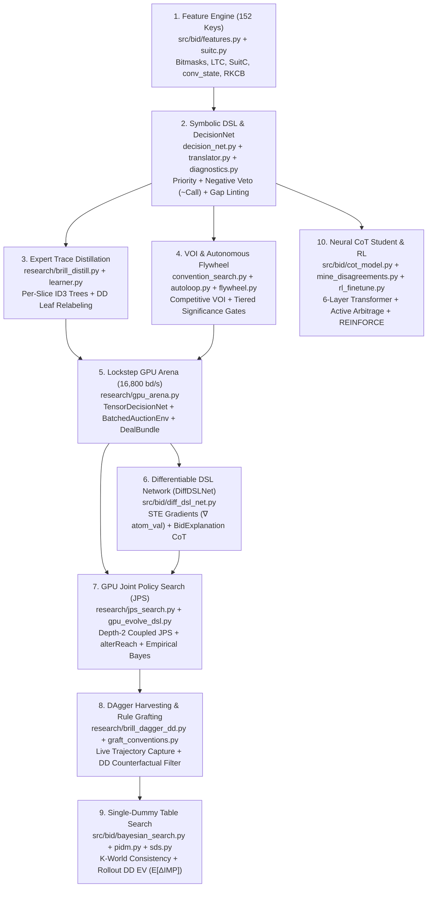

# Holistic Review of Methods & Colab GPU Superhuman Bidding Training Guide

This document provides a complete architectural and algorithmic review of all **10 methods** implemented across this repository (`src/bid/` and `research/`) and pairs directly with the hands-on Google Colab GPU notebook [`notebooks/train_superhuman_bidding_from_scratch.ipynb`](../notebooks/train_superhuman_bidding_from_scratch.ipynb).

---

## 1. End-to-End Architecture: How All 10 Methods Fit Together

Rather than treating symbolic Bridge rules and deep reinforcement learning / search as competing paradigms, the repository unifies them into a single neuro-symbolic pipeline where **every improvement compiles back into a 100% explainable, auditable `.dsl` rule set and `DiffDSLNet` checkpoint**:



---

## 2. Holistic Review of All 10 Repository Methods

### Method 1 — 152-Feature Bitmask Hand, `SuitC`, and Sequence-Exact Convention State Engine
- **Files**: [`src/bid/features.py`](../src/bid/features.py), [`src/bid/suitc.py`](../src/bid/suitc.py), [`research/gpu_arena.py`](../research/gpu_arena.py)
- **What it does**:
  - Computes `152` canonical hand and auction features using precomputed integer suit bitmasks (`Hand.suit_masks`), splitting cleanly into ~90 static hand features (`hcp`, suit lengths, `losing_trick_count`, `quick_tricks`, `controls`, `rule20_total`, `rule_of_15`, `first_round_controls`, `second_round_controls`, `*_realsolid`, `SuitC` `long_suit_intermediates` / `short_suit_wasted_hcp`) and ~62 dynamic auction features updated in lockstep on GPU (`BatchedAuctionEnv`).
  - Integrates Gerrit van der Velde's native `bin/SuitC` solver (`SuitCSolver`) for single-dummy expected tricks, safety plays, and stopper analysis.
  - Implements an 11-state sequence-exact convention and slam finite-state machine (`conv_state`), resolving `effective_trump`, `rkcb_keycards`, `rkcb_has_queen`, `rkcb_0314_step`, `outside_king_count`, `partner_kc_promised`, `total_partnership_keycards`, `seq_partner_hcp_min`, `combined_fit_len_est`, and explicit opponent-suit flags (`opp_bid_*`) with **0-mismatch CPU/GPU parity**.
- **Strengths & Limitations**: Eliminates Python dictionary overhead during GPU rollouts and fixes turn-3+ convention blindness (Jacoby `2NT` vs. natural `2NT`, RKCB `0314` keycard count). Must maintain strict CPU/GPU parity whenever new dynamic keys are added.

### Method 2 — Declarative `.dsl` Compiler, Priority/Veto `DecisionNet`, and Gap Diagnostics
- **Files**: [`src/bid/decision_net.py`](../src/bid/decision_net.py), [`src/bid/translator.py`](../src/bid/translator.py), [`src/bid/lint_dsl.py`](../src/bid/lint_dsl.py), [`src/bid/diagnostics.py`](../src/bid/diagnostics.py), [`src/bid/coverage_gap.py`](../src/bid/coverage_gap.py)
- **What it does**:
  - Parses symbolic `.dsl` rules of flat conjunctions (`feature op constant`), positive priorities (`PRIORITY`), and negative vetoes (`NEGATIVE: True`). Resolves ties deterministically by `(-priority, str(call))` after filtering for legal bridge calls (`PASS, 1C..7NT, X, XX`).
  - `ParDiagnosticEngine` compares actual contracts against Double-Dummy Par and classifies bidding flaws (`MISSED_GAME`, `MISSED_SLAM`, `SOFT_DEFENSE`, `OVERBID_DOWN`, `MISSED_PENALTY_DBL`, `TAKEOUT_PASS`).
- **Strengths & Limitations**: Human-readable, git-diffable, and 100% browser-exportable (`src/bid/web_export.py`). Flat rule matching alone has zero gradient signal, which motivates Methods 5–7.

### Method 3 — Expert Trace Distillation via Per-Slice ID3 Trees & DD Leaf Relabeling
- **Files**: [`research/brill_distill.py`](../research/brill_distill.py), [`src/bid/learner.py`](../src/bid/learner.py), [`research/merge_dsl.py`](../research/merge_dsl.py), [`research/leaf_ceiling.py`](../research/leaf_ceiling.py)
- **What it does**:
  - Groups expert bidding traces (`data/brill_traces_330k.jsonl`) by auction slice (`open_uncont`, `later_uncont`, `later_cont`) and fits Shannon information-gain `ID3DecisionTree` classifiers (`id3_tree_to_rules`) into `__slots__`-optimized feature rows.
  - Supports `--relabel outcome` to replace majority-vote leaf actions with the highest expected Double-Dummy outcome observed inside each leaf.
- **Strengths & Limitations**: Converts hundreds of thousands of opaque expert traces into ~`1,833` fast symbolic rules in minutes, but pure imitation cannot surpass the teacher (`~78-83%` turn fidelity) and suffers compounding error when deviating off-policy.

### Method 4 — Competitive VOI Convention Synthesis & Autonomous Flywheel
- **Files**: [`src/bid/convention_search.py`](../src/bid/convention_search.py), [`src/bid/autoloop.py`](../src/bid/autoloop.py), [`src/bid/flywheel.py`](../src/bid/flywheel.py), [`src/bid/optimizer.py`](../src/bid/optimizer.py)
- **What it does**:
  - `convention_search.py` mutates parameterized `ConventionProtocol` objects (target feature, threshold shifts, response swaps, priority bumps) scored by Competitive Value of Information (`Net VOI = VOI_partner - λ_leak * Leakage + λ_preempt * Disruption`).
  - `flywheel.py` and `autoloop.py` generate targeted mutations from `ParDiagnosticEngine` flaws, screen on small board tiers (`8 -> 24 -> 96` boards) using paired $z$-statistics (`|z| >= 2.0`), gate by `SDSScorer`, and auto-promote champions to `system/champion_system.dsl`.
- **Strengths & Limitations**: Principled anti-overfitting statistical gates on CPU, but CPU `BiddingArena` runs at only ~`4 boards/sec`.

### Method 5 — Lockstep GPU-Vectorized Arena (`TensorDecisionNet`, `BatchedAuctionEnv`, `DealBundle`)
- **Files**: [`research/gpu_arena.py`](../research/gpu_arena.py), [`docs/GPU_ACCELERATION.md`](./GPU_ACCELERATION.md)
- **What it does**:
  - Deduplicates all unique `(feature, op, threshold)` conditions into $U$ atoms, evaluates `(B, U)` once per step, computes all $R$ rule conjunctions in a single Tensor-Core matrix multiply `(B, U) @ (U, R)`, and applies priorities via `64 * prio - lex_rank(call)`.
  - Precomputes 20-entry Double-Dummy tables `(B, 4, 5)` and exact WBF duplicate score lookup tables (`SCORE_LUT: (36, 3, 2, 14)`) inside `DealBundle` `.pt` archives, hitting **16,817 boards/sec on Colab A100** (**300x–4,000x faster than CPU**).
  - Provides `gpu_continuation_q_values(bundle, net, prefix_calls)` to score all `38` candidate calls by rolling out full auctions on GPU (~`4,200 rollouts/sec`).

### Method 6 — Neuro-Symbolic Differentiable DSL Network (`DiffDSLNet`) with STE Gradients & 100% Explainability
- **Files**: [`src/bid/diff_dsl_net.py`](../src/bid/diff_dsl_net.py), [`docs/DIFF_DSL_NET.md`](./DIFF_DSL_NET.md)
- **What it does**:
  - Compiles `.dsl` rules directly into `nn.Module` parameters: `atom_val` ($\theta_u$), `rule_atom_logits` ($W_{\text{rule}}$), `rule_prio_param`, and `rule_call_logits`, plus an auxiliary `partner_belief_net`, `value_head`, and 10-strain Double-Dummy trick predictor `dd_pred_head`.
  - In `soft=False` mode, matches `DecisionNet.best_call` with **0 mismatches**. In `soft=True` mode, replaces step gates with Straight-Through Estimator (STE) sigmoids ($\beta = 10.0$) so gradients $\nabla_{\theta_u} \mathcal{L}$ flow backward into continuous rule thresholds.
  - Guarantees **100% explainable output** on every bid via `BidExplanation` and `.to_cot_str()`, and exports weights losslessly back to `.dsl` via `export_dsl()`.

### Method 7 — Multi-Generation GPU Joint Policy Search (`JPS`) & League Self-Play
- **Files**: [`research/jps_search.py`](../research/jps_search.py), [`research/gpu_evolve_dsl.py`](../research/gpu_evolve_dsl.py), [`docs/JPS_INTEGRATION.md`](./JPS_INTEGRATION.md)
- **What it does**:
  - Solves cooperative multi-agent local optima in Bridge across 4 iterative stages per generation:
    0. **Online Auxiliary Head Training**: Fits `partner_belief_net`, `value_head`, and `dd_pred_head` on self-play rollouts.
    1. **Depth-2 Coupled JPS + `alterReach`**: Jointly searches `(r_1 -> c_1', r_2 -> c_2')` pairs in packed GPU mega-batches using Empirical Bayes reachability shrinkage ($\frac{N}{N+\lambda} \overline{\Delta \text{IMP}}$).
    2. **STE Gradient-Guided Threshold Shifts**: Uses `compute_ste_gradient_importance` ($\nabla_{\theta_u}(-V + 0.25 H(\pi))$) to rank and refine continuous thresholds.
    3. **Mega-Batched Partner-Belief & Fit Condition Splits**: Evaluates thousands of candidate splits (`combined_hcp_min`, `combined_fit_len_est`, `opp_suit_stoppers`, `controls`, `SuitC` intermediates) via `DiffDSLNet.clone_and_split_rule`.
  - Validates every edit against a growing **League Pool** of prior generations and external opponents across disjoint Train and Validation sets.

### Method 8 — Interactive DAgger Harvesting & Double-Dummy Counterfactual Grafting
- **Files**: [`research/brill_dagger.py`](../research/brill_dagger.py), [`research/brill_dagger_dd.py`](../research/brill_dagger_dd.py), [`research/graft_conventions.py`](../research/graft_conventions.py)
- **What it does**:
  - Runs the student policy directly against live or external opponents (`BrillClient`) so training states match the exact on-policy competitive distribution, avoiding fallthrough `PASS` errors.
  - Filters disagreement labels against exact 20-entry Double-Dummy IMPs (instead of blindly cloning suboptimal calls) and grafts high-priority convention/slam sub-trees directly into `DiffDSLNet`.
  - Combined with Program 1 & 3–4, turned our 16-board match vs. live Remote Brill from **`-3.19 IMP/bd` to `+2.50 ± 1.08 IMP/bd` ($t = +2.31$)**.

### Method 9 — Imperfect-Information Single-Dummy Search (`SDSScorer`, `PIDMEngine`, `BayesianSingleDummyBidder`)
- **Files**: [`src/bid/bayesian_search.py`](../src/bid/bayesian_search.py), [`src/bid/pidm.py`](../src/bid/pidm.py), [`src/bid/sds.py`](../src/bid/sds.py), [`src/bid/sampling.py`](../src/bid/sampling.py)
- **What it does**:
  - At the bidding table, generates $K$ unseen 39-card completions consistent with auction HCP/suit-length bounds (`_infer_seat_constraints`) and vectorized `TensorDecisionNet` past-turn likelihood (`BayesianSingleDummyBidder`) or `RBMBMCSampler` (`PIDMEngine`).
  - Rolls out top candidate calls via `BatchedAuctionEnv` / `PIDMEngine.lookahead` and evaluates exact `DDSolver` terminal IMPs, attaching quantitative EV (`sd_rollout_ev_imp`, `sd_rollout_t_stat`) directly to `BidExplanation`.

### Method 10 — Neural Chain-of-Thought (`CoT`) Transformer Student, Active Mining & RL Fine-Tuning
- **Files**: [`src/bid/cot_model.py`](../src/bid/cot_model.py), [`src/bid/cot_bidder.py`](../src/bid/cot_bidder.py), [`src/bid/build_cot_dataset.py`](../src/bid/build_cot_dataset.py), [`src/bid/mine_disagreements.py`](../src/bid/mine_disagreements.py), [`src/bid/refresh_student.py`](../src/bid/refresh_student.py), [`src/bid/rl_finetune.py`](../src/bid/rl_finetune.py)
- **What it does**:
  - Trains a 6-layer, 256-dim (~5M param) causal Transformer (`COTModel`) on symbolic rule explanations (`trace_factory.py`) with cross-entropy loss masked to post-`<sep>` reasoning + bid tokens, constrained decoding over legal bids, active disagreement arbitration (`mine_disagreements.py`), automated incumbent gating (`refresh_student.py`), and policy-gradient `REINFORCE` self-play against Double-Dummy IMP rewards (`rl_finetune.py`).

---

## 3. Method Comparison Matrix

| Method | Optimization Unit | Training Compute | Inference Latency | Explainability | Best Role in Training From Scratch |
| :--- | :--- | :--- | :--- | :--- | :--- |
| **Hand-Authored DSL + Gaps** | Rules | Seconds (CPU) | `< 1 ms` | 100% | Warm-start seed (`PASS, 1C..7NT, X, XX`) |
| **ID3 + GPU Q-Table Rollouts** | Subtrees & Labels | Seconds–Minutes (GPU) | `< 1 ms` | 100% | Rapidly growing from 28 rules to 500–1,800 rules |
| **`DiffDSLNet` + `JPS` (GPU)** | Coupled Rule Pairs, $\theta_u$, Splits | 15–90 min (Colab GPU) | `< 1 ms` | 100% | Escaping partnership local optima & tuning thresholds |
| **DAgger + DD Grafting** | Off-Policy States & Conventions | 5–60 min | `< 1 ms` | 100% | Closing competitive gaps & slamming conventions |
| **`BayesianSingleDummyBidder`** | Table Lookahead ($K$ Worlds) | None (Test-time) | `50–250 ms` | 100% (Rule + EV) | High-leverage competitive / game / slam decisions |
| **CoT Transformer + REINFORCE** | ~5M Dense Params | 20–120 min (GPU) | `15–40 ms` | Generative CoT | Alternative sequence-model student |

---

## 4. Practical Google Colab GPU Recipe

Run the interactive notebook [`notebooks/train_superhuman_bidding_from_scratch.ipynb`](../notebooks/train_superhuman_bidding_from_scratch.ipynb) on Colab with the following GPU tier sizing:

| Colab GPU Tier | Cost Rate | Best For | Recommended `--bundle` & `--generations` | Expected Runtime |
| :--- | :---: | :--- | :--- | :---: |
| **`Tesla T4` (16 GB)** | `1.15 CU/hr` | Tutorial walkthrough, `B <= 2,500`, Stages 1–5 + 1-Gen JPS | `colab_bundle_500.pt` / `2,500` boards, `--generations 2` | `5 – 15 min` |
| **`NVIDIA L4` (24 GB)** *(Recommended)* | `1.94 CU/hr` | Full `B = 10,000+` from-scratch self-play + Multi-Gen JPS | `colab_bundle_10k.pt`, `--generations 3 --gpu-scale` | `20 – 45 min` |
| **`NVIDIA A100` (40 GB)** | `6.73 CU/hr` | Large `B >= 25,000` JPS sweeps & CoT Transformer RL | `colab_bundle_10k.pt` / `50k`, `--generations 6 --gpu-scale` | `15 – 40 min` |

### One-Line CLI Equivalent on Colab GPU
```bash
PYTHONPATH=src:research python3 research/jps_search.py \
  --bundle data/colab_bundle_10k.pt \
  --dsl system/champion_system.dsl \
  --out-dsl system/scratch_jps_evolved.dsl \
  --out-pt data/scratch_jps.pt \
  --generations 3 --gpu-scale --device cuda
```
